# Lumo — thème Jellyfin

Un thème sombre pour **Jellyfin 12**, pensé comme une application de streaming, sans toucher aux fichiers de Jellyfin.

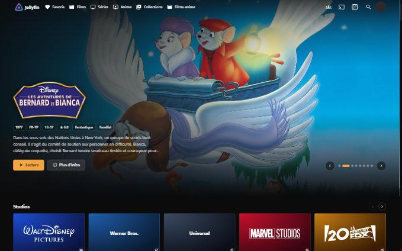

```bash
curl -fsSL https://raw.githubusercontent.com/0x80070006/Lumo-jellyfin-theme/main/install.sh | bash
```

→ [Guide d'installation complet](docs/INSTALLATION.md)

## Ce que Lumo apporte

- **Hero cinématique** en haut de l'accueil : logo du titre, année, durée, note, genres, résumé, boutons *Lecture* et *Plus d'infos*. Il change tout seul, se met en pause au survol et répond au balayage tactile comme aux flèches du clavier.
- **Studios** et **Plateformes** en tuiles-logos, 5 par 5, avec flèches. Un clic ouvre tous les titres du studio, même répartis sur plusieurs noms : Walt Disney Pictures, Walt Disney Animation Studios… sont regroupés.
- **Ajouts récents** par bibliothèque, avec les séries et les animes regroupés **par série** (jamais par épisode ou par saison).
- **10 rangées par genre** et des **rangées par studio** : 5 affiches visibles, 15 au total, puis une tuile *Voir plus*.
- **Le dé** à côté de la recherche : choisissez films ou séries, **un ou plusieurs genres**, une **durée** (ou sans préférence), « seulement ce que je n'ai pas vu », et une roulette tire un titre pour vous. Elle ne propose jamais deux fois de suite les mêmes titres.
- **Le tournoi** (la coupe, à côté du dé) : 8 titres s'affrontent en duels, de 2 en 2, jusqu'à la finale. Le vainqueur se lance, sous les confettis. Idéal à plusieurs : chacun vote un duel.
- **Tuiles uniformes** : toutes les affiches à la même taille, les vignettes « Continuer à regarder » aussi. Le survol ne déplace rien, donc plus de chevauchement.
- **Une couleur dominante**, modifiable en une ligne.

Principes : uniquement l'API publique de Jellyfin, aucun contenu natif masqué, chaque module échoue seul (l'interface native reste utilisable), rangées chargées à l'approche de l'écran.

## Couleurs

Cinq palettes prêtes à l'emploi, dans [`themes/`](themes). Remplacez le bloc `:root` de *CSS personnalisée* par l'une d'elles, ou passez-la au script :

```bash
curl -fsSL https://raw.githubusercontent.com/0x80070006/Lumo-jellyfin-theme/main/install.sh | bash -s -- --accent "#e50914" --ink "#ffffff"
```

| Palette | Couleur | Fichier | Aperçu |
| --- | --- | --- | --- |
| Ambre (par défaut) | `#f2a541` | [`themes/ambre.css`](themes/ambre.css) | [voir](docs/screenshots/accueil-ambre.jpg) |
| Rouge cinéma | `#e50914` | [`themes/rouge.css`](themes/rouge.css) | [voir](docs/screenshots/accueil-rouge.jpg) |
| Violet | `#8b5cf6` | [`themes/violet.css`](themes/violet.css) | [voir](docs/screenshots/accueil-violet.jpg) |
| Bleu glacier | `#5ab0ff` | [`themes/glacier.css`](themes/glacier.css) | [voir](docs/screenshots/accueil-glacier.jpg) |
| Vert menthe | `#3ecf8e` | [`themes/menthe.css`](themes/menthe.css) | [voir](docs/screenshots/accueil-menthe.jpg) |

<table>
  <tr>
    <td>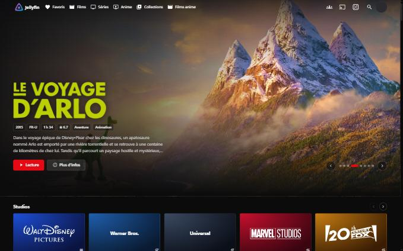<br><sub>Rouge cinéma</sub></td>
    <td>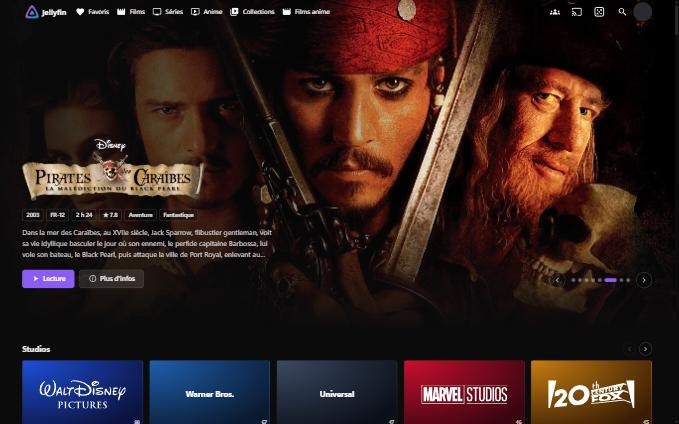<br><sub>Violet</sub></td>
  </tr>
  <tr>
    <td>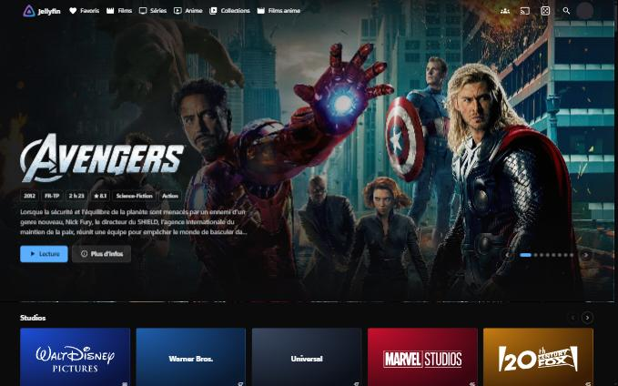<br><sub>Bleu glacier</sub></td>
    <td>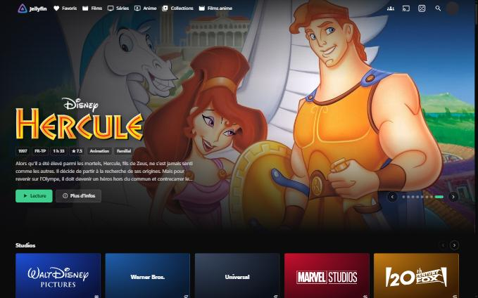<br><sub>Vert menthe</sub></td>
  </tr>
</table>

Exemple de bloc (palette rouge) :

```css
:root {
  --lumo-accent: #e50914;      /* boutons, liserés, points du hero, roulette */
  --lumo-accent-ink: #ffffff;  /* texte posé sur la couleur dominante */
}
```

Autres variables disponibles : `--lumo-bg`, `--lumo-bg-raised`, `--lumo-surface`, `--lumo-text`, `--lumo-text-dim`, `--lumo-radius`, `--lumo-radius-card`.

## Le dé

Un clic sur le dé, à côté de la loupe : l'arrière-plan se floute, vous réglez vos critères, et la roulette s'arrête sur un titre, avec *Lecture* ou *Voir la fiche*. *Relancer* tire toujours un autre titre.

| Critère | Choix |
| --- | --- |
| Type | Films, Séries, Les deux |
| Genres | Tous, ou un ou plusieurs genres (Action, Fantastique, Horreur…) |
| Durée (films) | Sans préférence, moins de 1 h 30, 1 h 30 à 2 h, plus de 2 h |
| Déjà vus | « Seulement ce que je n'ai pas vu » |

Les critères sont mémorisés d'une fois sur l'autre.

<table>
  <tr>
    <td>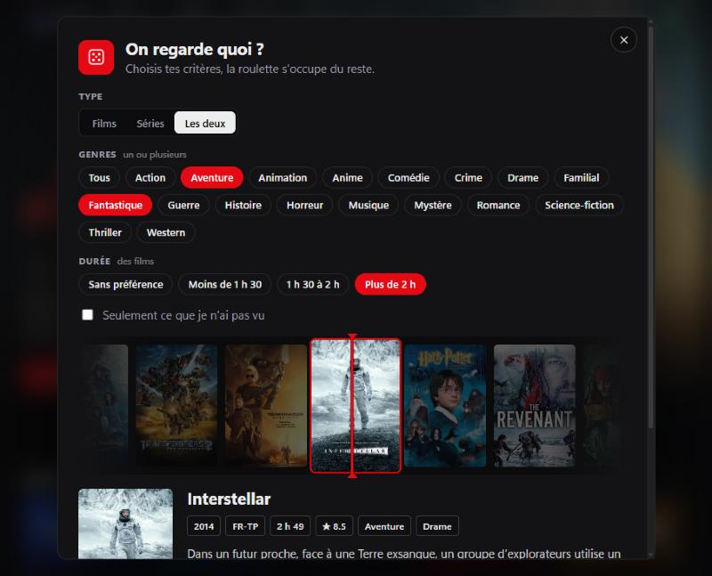<br><sub>Plusieurs genres, durée, la roulette tourne</sub></td>
    <td>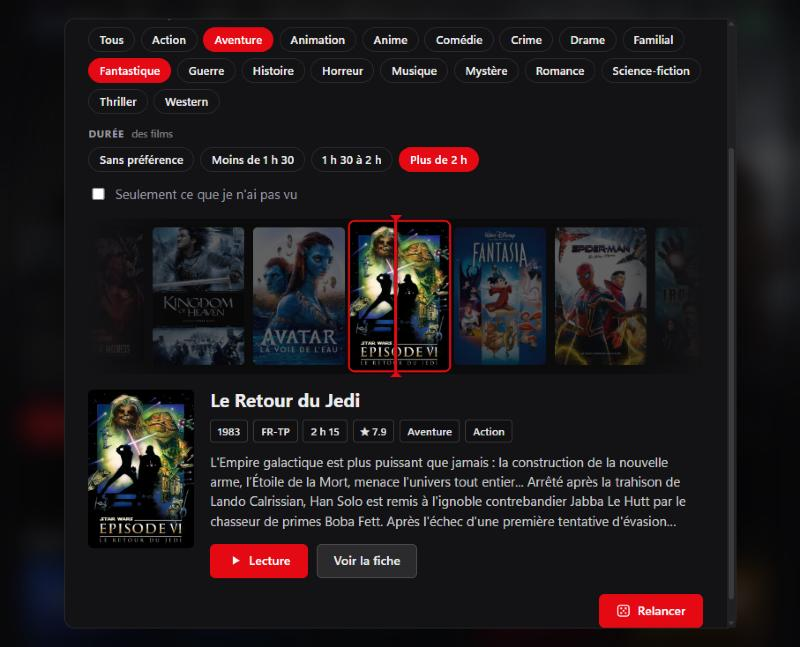<br><sub>La roulette s'arrête sur un titre</sub></td>
  </tr>
</table>

## Le tournoi

La coupe, à côté du dé. Mêmes critères que le dé, puis **8 titres** s'affrontent : quarts de finale, demi-finales, finale. Cliquez sur votre préféré (ou flèches ← → du clavier) ; le perdant sort, le gagnant passe au tour suivant. Le vainqueur s'affiche avec les titres qu'il a battus, sous les confettis, prêt à être lancé. S'il y a moins de 8 titres pour vos critères, le tournoi se joue à 4 ou à 2.

<table>
  <tr>
    <td>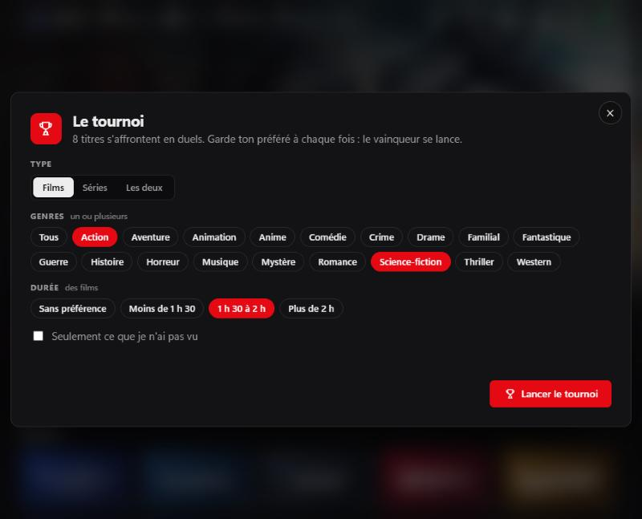<br><sub>Les critères</sub></td>
    <td>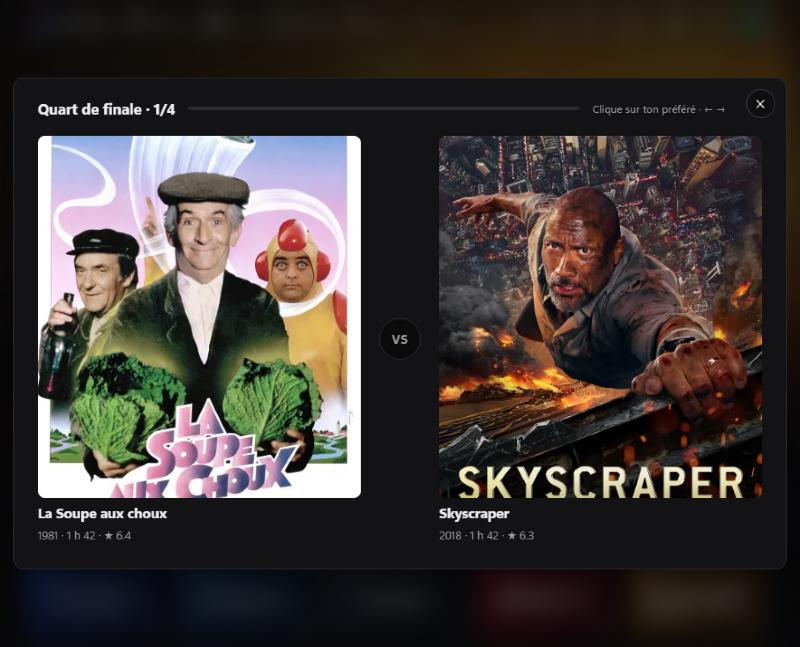<br><sub>Un duel : choisissez votre préféré</sub></td>
  </tr>
  <tr>
    <td colspan="2">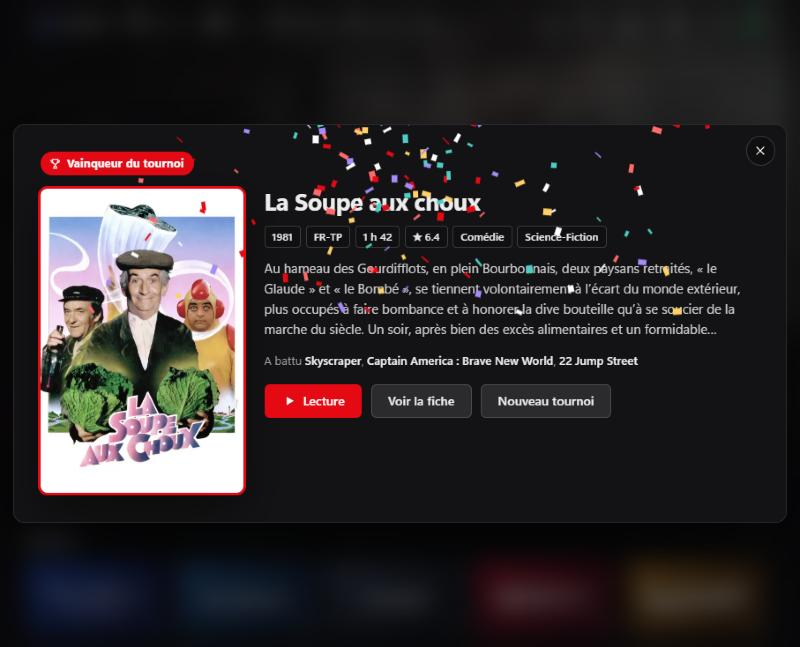<br><sub>Le vainqueur, sous les confettis</sub></td>
  </tr>
</table>

## Les écrans

<table>
  <tr>
    <td>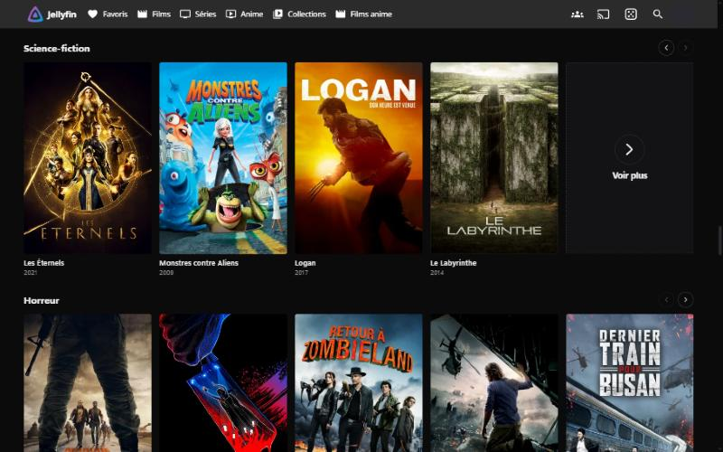<br><sub>Rangées par genre, 5 par 5, tuile « Voir plus »</sub></td>
    <td>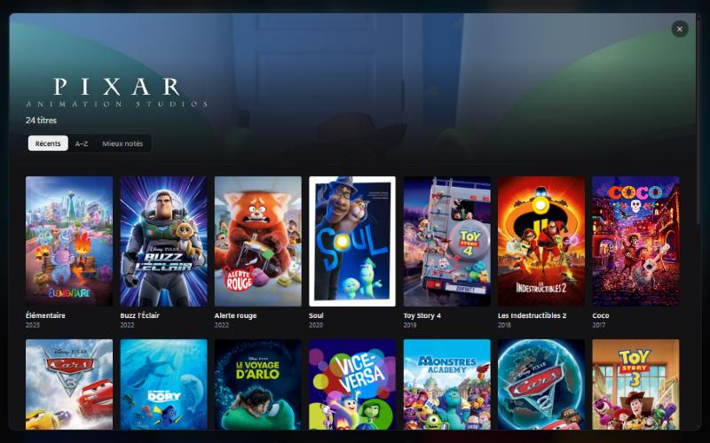<br><sub>Fiche d'un studio : tous ses titres</sub></td>
  </tr>
  <tr>
    <td>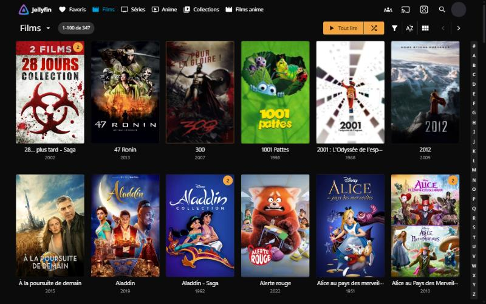<br><sub>Bibliothèque native, affiches uniformes</sub></td>
    <td>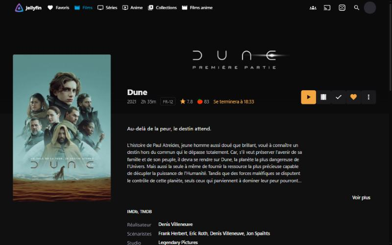<br><sub>Fiche d'un film</sub></td>
  </tr>
</table>

<p align="center">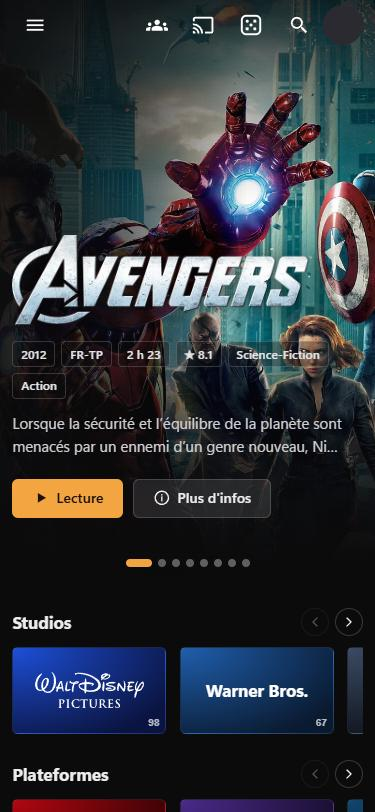<br><sub>Sur téléphone</sub></p>

## Installation

En root, dans le conteneur ou la machine Jellyfin :

```bash
curl -fsSL https://raw.githubusercontent.com/0x80070006/Lumo-jellyfin-theme/main/install.sh | bash
```

Le script installe les plugins nécessaires (File Transformation, JavaScript Injector), sauvegarde la configuration, puis écrit **une ligne** dans *CSS personnalisée* et **une ligne** dans *JavaScript Injector* : tout le code reste sur GitHub. Il ne vous reste que la couleur à régler :

```css
/* Lumo 1.3.0 — le thème est chargé depuis GitHub ; relancez install.sh pour mettre à jour. */
@import url("https://cdn.jsdelivr.net/gh/0x80070006/Lumo-jellyfin-theme@1.3.0/lumo.css");

:root {
  --lumo-accent: #f2a541;      /* couleur dominante */
  --lumo-accent-ink: #1a1206;  /* texte posé dessus */
}
```

Relancez la commande pour mettre à jour ; `--uninstall` retire tout ; `--inline` copie tout le code dans Jellyfin pour un serveur sans Internet.

Détails, options, installation à la main, réglages conseillés de Home Screen Sections et dépannage : **[docs/INSTALLATION.md](docs/INSTALLATION.md)**.

## Logos

Les logos de studios proviennent de Wikimedia Commons (voir [`assets/logos/SOURCES.md`](assets/logos/SOURCES.md)). Les marques appartiennent à leurs titulaires. Les captures d'écran montrent des affiches de films à titre d'illustration.

## Licence

MIT
